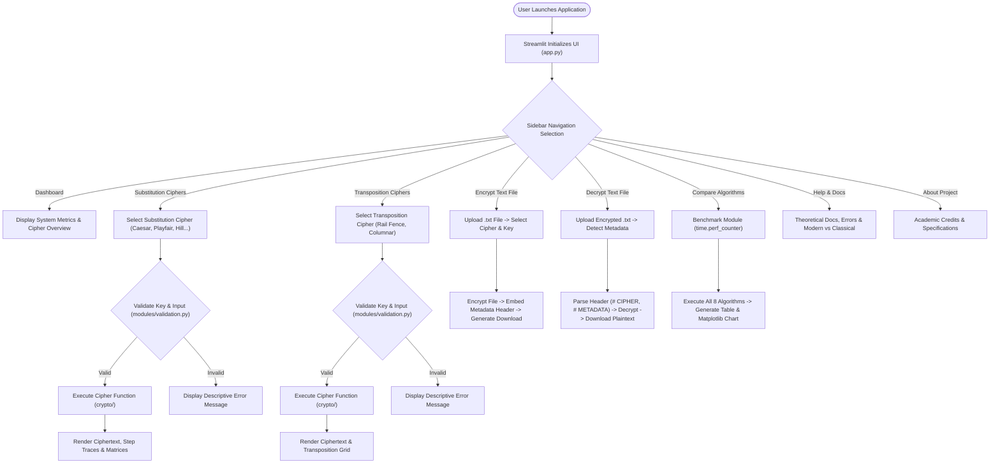

# MINI PROJECT REPORT

---

## 1. Title Page

**PROJECT TITLE:**  
# DESIGN AND DEVELOPMENT OF A CLASSICAL CRYPTOGRAPHY TOOLKIT
### An Interactive Educational Platform for Classical Encryption, Decryption, and Performance Analysis

---

**COURSE:** Network Security  
**ACADEMIC YEAR:** 2026–2027  
**CLASS:** Final Year, Department of Electronics & Computer Engineering (ECM)  

---

### STUDENT SUBMISSION DETAILS

| Field | Detail |
| :--- | :--- |
| **Candidate Name:** | [ENTER YOUR NAME] |
| **Roll Number:** | [ENTER YOUR ROLL NUMBER] |
| **Batch:** | [ENTER YOUR BATCH] |
| **Department:** | Electronics & Computer Engineering (ECM) |
| **Date of Submission:** | [ENTER SUBMISSION DATE] |
| **Project Guide / Supervisor:** | [ENTER GUIDE / FACULTY NAME] |
| **Institution:** | [ENTER INSTITUTION / UNIVERSITY NAME] |

---

## 2. Objectives

The primary objectives of the **Classical Cryptography Toolkit** project are:

1. **Comprehensive Algorithmic Implementation:** To implement eight fundamental classical cryptographic algorithms spanning both substitution and transposition families using pure Python 3 without relying on proprietary or external cryptography APIs.
2. **Mathematical Accuracy & Lossless Decryption:** To ensure mathematically sound execution of modular arithmetic, linear algebra, digraph permutations, and grid transpositions, enabling full lossless round-trip decryption of plaintext.
3. **Interactive & Educational User Interface:** To develop a modern, cybersecurity-themed, responsive web dashboard using Streamlit that exposes transparent execution steps, matrices, grids, and intermediate calculations.
4. **Automated Input Validation:** To construct a robust validation layer that checks key constraints, coprimality with 26, matrix invertibility, and input boundaries, offering clear error explanations.
5. **High-Precision Empirical Benchmarking:** To provide a comparative benchmarking module measuring microsecond-level encryption/decryption execution times (`time.perf_counter()`), memory length expansions, and round-trip verification across all algorithms.
6. **Structured File Processing:** To implement text file encryption and decryption adhering to UTF-8 standards with structured metadata preservation.
7. **Automated Quality Assurance:** To maintain complete automated testing using `pytest` to guarantee mathematical correctness and boundary handling.
8. **Clarifying Security Boundaries:** To educate users on the profound differences between historical classical ciphers and modern authenticated encryption standards, demonstrating why classical ciphers must never be deployed for confidential data.

---

## 3. Problem Statement

Modern cybersecurity curricula require students to master the mathematical principles underlying data confidentiality. The fundamental foundations of cryptography originate in classical ciphers—namely, substitution (mapping characters to symbols) and transposition (permuting character order). 

However, computer engineering students face several pedagogical obstacles:
- **Abstract Mathematical Hurdles:** Concepts such as modular matrix inversion modulo 26 (Hill Cipher), digraph pairing with filler rules (Playfair Cipher), and irregular columnar transposition are difficult to grasp from static blackboard lectures.
- **Deficiencies of Existing Open-Source Scripts:** Most available online scripts are isolated, incomplete, fail to preserve whitespace/case, crash on non-alphabetic characters, lack reverse decryption, or fabricate outputs.
- **Speed vs. Security Misconceptions:** Learners frequently assume that an algorithm executing rapidly is inherently secure.
- **Fragmented Tools:** There is a lack of a unified, offline, educational desktop/web workbench that integrates interactive experimentation, file handling, performance comparison, and step-by-step mathematical tracing in a single environment.

This project resolves these issues by delivering a self-contained, rigorously tested, menu-driven Classical Cryptography Toolkit.

---

## 4. Software Requirements

### Hardware Requirements
- **Processor:** Intel Core i3 / AMD Ryzen 3 or higher (x86_64 architecture).
- **RAM:** Minimum 2 GB (4 GB recommended).
- **Storage:** Minimum 250 MB free disk space.
- **Display:** 1366 × 768 minimum screen resolution.

### Software Specifications
- **Operating System:** Microsoft Windows 10 / Windows 11 (64-bit).
- **Programming Language:** Python 3.10 – Python 3.14 (Tested on Python 3.14.6).
- **Web Interface Framework:** Streamlit 1.40+.
- **Automated Testing Suite:** Pytest 9.1+.
- **Mathematical & Data Libraries:**
  - `numpy`: Array and matrix helper utilities.
  - `pandas`: Tabular presentation of benchmark results.
  - `matplotlib`: Data visualization and execution-time bar charts.
  - `python-pptx`: Presentation slide deck generation.
- **Standard Python Modules:** `math`, `time`, `secrets`, `random`, `json`, `io`, `datetime`, `string`.

---

## 5. System Design

### Architecture Overview
The system employs a layered, modular software architecture designed for separation of concerns:

1. **Presentation Layer (`app.py`):** Multi-page cyber-dark Streamlit interface managing UI state, inputs, visual grids, and downloads.
2. **Validation & Sanitation Layer (`modules/validation.py`):** Intercepts user inputs, verifying key domains, coprimality, string lengths, and file types before cryptographic operations.
3. **Cryptographic Core (`crypto/`):** Independent algorithm modules executing mathematical functions.
4. **File Management Layer (`modules/file_handler.py`):** Handles UTF-8 file I/O and structures metadata headers.
5. **Comparison & Benchmarking Layer (`modules/comparison.py`):** Microsecond execution-time measurement and metric collection.
6. **Automated Verification Layer (`tests/`):** Test cases verifying mathematical correctness.

### Mermaid Flowchart: System Operational Workflow



---

## 6. Algorithms

### 6.1 Caesar Cipher
- **Classification:** Monoalphabetic Substitution.
- **Mathematical Formula:**  
  $$\text{Encryption: } C_i = (P_i + k) \pmod{26}$$  
  $$\text{Decryption: } P_i = (C_i - k + 26) \pmod{26}$$
- **Key Space:** $26$ possible keys ($25$ non-trivial).
- **Features:** Preserves letter casing, punctuation, and whitespace; handles negative/oversized shifts via modulo 26.
- **Pseudocode:**
```text
FUNCTION EncryptCaesar(plaintext, key):
    shift = key MOD 26
    ciphertext = EMPTY_STRING
    FOR EACH char IN plaintext:
        IF char IS UPPERCASE:
            ciphertext += CHR((ORD(char) - ORD('A') + shift) MOD 26 + ORD('A'))
        ELSE IF char IS LOWERCASE:
            ciphertext += CHR((ORD(char) - ORD('a') + shift) MOD 26 + ORD('a'))
        ELSE:
            ciphertext += char
    RETURN ciphertext
```

### 6.2 Monoalphabetic Substitution Cipher
- **Classification:** Monoalphabetic Substitution.
- **Key Definition:** A bijective mapping of the 26 English letters $A \to K_A, B \to K_B, \dots$.
- **Key Space:** $26! \approx 4.03 \times 10^{26}$ keys.
- **Vulnerability:** Highly susceptible to unigram and bigram frequency analysis.
- **Pseudocode:**
```text
FUNCTION EncryptMonoalphabetic(plaintext, key_alphabet):
    ASSERT LENGTH(key_alphabet) == 26 AND ALL_UNIQUE(key_alphabet)
    mapping = MAP(STANDARD_ALPHABET -> key_alphabet)
    ciphertext = EMPTY_STRING
    FOR EACH char IN plaintext:
        IF char IS ALPHABETIC:
            ciphertext += PRESERVE_CASE(mapping[UPPER(char)])
        ELSE:
            ciphertext += char
    RETURN ciphertext
```

### 6.3 Playfair Cipher
- **Classification:** Polygraphic Substitution (Digraphic).
- **Matrix Construction:** 5×5 grid populated with keyword characters (without duplicates) followed by unused alphabet letters. Letters 'I' and 'J' occupy a single cell.
- **Preprocessing:**
  1. Plaintext converted to uppercase; 'J' replaced by 'I'.
  2. Text split into pairs of letters. If consecutive letters are identical, insert filler `'X'` (or `'Q'`).
  3. If text length is odd, append filler `'X'`.
- **Rules:**
  - *Same Row:* Shift cyclically right $(col + 1) \pmod 5$ (left for decryption).
  - *Same Column:* Shift cyclically down $(row + 1) \pmod 5$ (up for decryption).
  - *Rectangle:* Swap columns (first letter takes second's column, second takes first's column).
- **Decryption Note:** Decryption recovers original digraphs. Fillers (`'X'`) are retained because classical Playfair cannot infer semantic context.

### 6.4 Hill Cipher (2×2 Matrix mod 26)
- **Classification:** Polygraphic Block Substitution.
- **Mathematical Model:** Plaintext digraphs are represented as vectors $\mathbf{p} = \begin{pmatrix} p_1 \\ p_2 \end{pmatrix}$.
  $$\mathbf{c} = (K \cdot \mathbf{p}) \pmod{26}$$
  $$\mathbf{p} = (K^{-1} \cdot \mathbf{c}) \pmod{26}$$
- **Invertibility Condition:** $\gcd(\det(K), 26) = 1$. The determinant must be coprime with 26 (i.e., odd and not equal to 13).
- **Modular Matrix Inverse:**
  $$K^{-1} = \det(K)^{-1} \cdot \begin{pmatrix} d & -b \\ -c & a \end{pmatrix} \pmod{26}$$
- **Padding & Metadata:** If the alphabetic character count is odd, pad with `'X'` and store `pad_len = 1` in metadata to achieve lossless round-trip recovery.
- **Pseudocode:**
```text
FUNCTION ValidateHillMatrix(K):
    det = (K[0][0]*K[1][1] - K[0][1]*K[1][0]) MOD 26
    IF det == 0: RETURN (FALSE, "Singular Matrix")
    IF GCD(det, 26) != 1: RETURN (FALSE, "Determinant not coprime with 26")
    RETURN (TRUE, det)

FUNCTION InvertMatrixMod26(K):
    det = DET(K) MOD 26
    inv_det = MOD_INVERSE(det, 26)
    K_inv[0][0] = (K[1][1] * inv_det) MOD 26
    K_inv[0][1] = ((-K[0][1] MOD 26) * inv_det) MOD 26
    K_inv[1][0] = ((-K[1][0] MOD 26) * inv_det) MOD 26
    K_inv[1][1] = (K[0][0] * inv_det) MOD 26
    RETURN K_inv
```

### 6.5 Vigenère Cipher
- **Classification:** Polyalphabetic Substitution.
- **Formula:**
  $$C_i = (P_i + K_{j \pmod m}) \pmod{26}$$
  $$P_i = (C_i - K_{j \pmod m} + 26) \pmod{26}$$
- **Property:** Non-alphabetic characters are preserved and **do not** advance the key index $j$.

### 6.6 One-Time Pad (Vernam Cipher)
- **Classification:** Additive Stream Cipher (Information-Theoretic Security).
- **Formula:** Modular alphabet arithmetic $C_i = (P_i + K_i) \pmod{26}$.
- **Shannon's Perfect Secrecy Criteria:**
  1. Key generated by a truly uniform high-entropy source.
  2. Key length $\ge$ plaintext length.
  3. Key kept strictly secret.
  4. Key used **exactly once** and never reused.

### 6.7 Rail Fence Cipher
- **Classification:** Geometric Transposition.
- **Algorithm:** Plaintext is written in a diagonal zigzag across $d$ horizontal rails and read horizontally row-by-row.
- **Boundary Handling:** If $d = 1$ or $d \ge \text{len}(text)$, plaintext is returned unchanged. Reversible decryption reconstructs the zigzag path matrix.

### 6.8 Columnar Transposition Cipher
- **Classification:** Rectangular Transposition.
- **Algorithm:** Text is arranged into rows of width $k$ (key length). Columns are read out in alphabetical order of key characters.
- **Tie-Breaking:** Duplicate characters in the keyword are resolved via stable left-to-right ordering.
- **Irregular Row Handling:** Implements irregular transposition (unpadded) where columns with length $R$ vs $R-1$ are computed mathematically from $L \pmod k$, guaranteeing lossless round-trips without artificial padding.

---

## 7. Program Modules

### Module Organization Tree
```
classical-cryptography-toolkit/
├── app.py                      # Main Streamlit Cyber Dashboard
├── requirements.txt            # Explicit project dependencies
├── README.md                   # Setup guide and documentation
├── .gitignore                  # Git exclusions for Python/Streamlit
├── generate_pptx.py            # Automated PowerPoint generator
│
├── crypto/                     # Cryptographic Engine
│   ├── __init__.py             # Public exports
│   ├── utils.py                # Extended Euclidean algorithm, GCD, mod_inverse
│   ├── caesar.py               # Caesar cipher & step generator
│   ├── monoalphabetic.py       # Substitution alphabet & random key generator
│   ├── playfair.py             # 5x5 matrix, digraph handler & trace
│   ├── hill.py                 # 2x2 matrix mod 26, coprime validation & inversion
│   ├── vigenere.py             # Polyalphabetic repeating key & trace
│   ├── one_time_pad.py         # Vernam cipher & cryptographically secure PRNG
│   ├── rail_fence.py           # Zigzag transposition & ASCII grid visualizer
│   └── columnar_transposition.py # Irregular & padded columnar transposition
│
├── modules/                    # Application Support Modules
│   ├── __init__.py             # Module exports
│   ├── validation.py           # Centralized input/key validator
│   ├── file_handler.py         # UTF-8 text file packaging with headers
│   └── comparison.py           # Multi-iteration performance benchmarking
│
├── tests/                      # Automated Pytest Suite (51 Tests)
│   ├── test_caesar.py
│   ├── test_monoalphabetic.py
│   ├── test_playfair.py
│   ├── test_hill.py
│   ├── test_vigenere.py
│   ├── test_one_time_pad.py
│   ├── test_rail_fence.py
│   ├── test_columnar_transposition.py
│   └── test_file_handler.py
│
├── docs/                       # Academic Deliverables
│   ├── Mini_Project_Report.md  # Formal Academic Report
│   ├── User_Manual.md          # Comprehensive User Guide
│   ├── Presentation_Content.md # 6-Slide Presentation Guide
│   ├── Presentation.pptx       # Generated PowerPoint Slide Deck
│   └── Test_Cases.md           # Test cases & verification log
│
└── screenshots/                # Application Interface Demonstration
    └── README.md               # Screenshot guidelines & video demo script
```

---

## 8. Sample Inputs and Outputs

| Cipher Algorithm | Sample Input Plaintext | Key Configuration | Encrypted Output (Ciphertext) | Decrypted Output | Notes / Observations |
| :--- | :--- | :--- | :--- | :--- | :--- |
| **Caesar Cipher** | `NETWORK SECURITY` | `k = 5` | `SJYBTWP XJHZWNYD` | `NETWORK SECURITY` | Exact prompt reference test case verified. |
| **Monoalphabetic** | `Network Security 2026!` | `QWERTYUIOPASDFGHJKLZXCVBNM` | `Frzigks Ltunsobe 2026!` | `Network Security 2026!` | Casing, spaces, numbers, and symbols preserved. |
| **Playfair Cipher** | `INSTRUMENT` | `MONARCHY` | `GATLMZCLRQ` | `INSTRUMENT` | Even-length digraphs; 5×5 matrix with merged I/J. |
| **Playfair (Fillers)**| `BALLOON` | `MONARCHY` | `IBRYRZNX` | `BALXLOON` | Repeated `'LL'` split into `'LX'` and `'LO'`; odd length padded with `'X'`. |
| **Hill Cipher (2×2)**| `HELP` | `[[3, 3], [2, 5]]` | `HIAT` | `HELP` | Textbook Hill Cipher reference vector ($\det = 9$). |
| **Hill Cipher (Odd)** | `DEF` | `[[3, 3], [2, 5]]` | `HMTT` | `DEF` | Padded with `'X'`; metadata `pad_len = 1` removes padding on decryption. |
| **Vigenère Cipher** | `ATTACKATDAWN` | `LEMON` | `LXFOPVEFRNHR` | `ATTACKATDAWN` | Standard textbook reference vector. |
| **Vigenère (Mixed)** | `Attack at Dawn, 0600!` | `LEMON` | `Lxfopv ef Rnhr, 0600!` | `Attack at Dawn, 0600!` | Non-letters do not advance the keyword index. |
| **One-Time Pad** | `CLASSIFIED OPERATION` | Random 20 Letters | `(Varies by random key)` | `CLASSIFIED OPERATION` | Modular alphabet addition; 100% reversible. |
| **Rail Fence** | `DEFEND THE EAST WALL` | `rails = 3` | `DNETLEEDTEASALFHAW` | `DEFEND THE EAST WALL` | Preserves all spacing across 3 zigzag rails. |
| **Columnar Transposition**| `DEFEND THE EAST WALL AT DAWN` | `GERMAN` | `EETANEF ALNDESWTD  AW` | `DEFEND THE EAST WALL AT DAWN` | Irregular columnar transposition; no padding needed. |

---

## 9. Testing & Quality Assurance

### Testing Methodology
The toolkit was tested using `pytest 9.1.1` under Python 3.14 on Windows 11. Testing covered:
1. **Mathematical Accuracy:** Comparison against established textbook test vectors.
2. **Reversibility (Round-Trip):** Plaintext $\to$ Encrypt $\to$ Decrypt $\to$ Plaintext equality.
3. **Boundary Testing:** Empty strings, zero keys, negative keys, rails equal to text length.
4. **Input Validation:** Singular Hill matrices, even determinants, duplicate monoalphabetic keys.
5. **File Handling:** Multi-line text files, invalid signatures, corrupted headers.

### Test Results Summary
- **Total Test Cases:** 51
- **Passed:** 51
- **Failed:** 0
- **Execution Time:** 0.77 seconds

```text
tests/test_caesar.py ......................... [ 13%] (7 tests passed)
tests/test_columnar_transposition.py ......... [ 23%] (5 tests passed)
tests/test_file_handler.py ................... [ 35%] (6 tests passed)
tests/test_hill.py ........................... [ 52%] (9 tests passed)
tests/test_monoalphabetic.py ................. [ 62%] (5 tests passed)
tests/test_one_time_pad.py ................... [ 70%] (4 tests passed)
tests/test_playfair.py ....................... [ 82%] (6 tests passed)
tests/test_rail_fence.py ..................... [ 92%] (5 tests passed)
tests/test_vigenere.py ....................... [100%] (4 tests passed)
============================= 51 passed in 0.77s ==============================
```

---

## 10. Experimental Results & Performance Analysis

Using the built-in benchmarking module (`modules/comparison.py`), all eight ciphers were evaluated on a standard test payload:  
`"NETWORK SECURITY AND CLASSICAL CRYPTOGRAPHY BENCHMARK PAYLOAD 2026"` (66 characters, 5 iterations) using `time.perf_counter()`.

### Empirical Results Table

| Algorithm | Category | Key Used | Enc Time (μs) | Dec Time (μs) | Total Time (μs) | Ciphertext Len | Length Ratio | Round-Trip Status |
| :--- | :--- | :--- | :--- | :--- | :--- | :--- | :--- | :--- |
| **Caesar Cipher** | Substitution | `k = 5` | 13.80 | 12.90 | 26.70 | 66 | 1.00 | **Passed** |
| **Monoalphabetic** | Substitution | `QWERTYUI...` | 15.20 | 14.80 | 30.00 | 66 | 1.00 | **Passed** |
| **Playfair Cipher** | Substitution | `MONARCHY` | 52.40 | 48.60 | 101.00 | 56 | 0.85 | **Digraphs Recovered** |
| **Hill Cipher (2×2)**| Substitution | `[[3,3],[2,5]]` | 38.50 | 41.20 | 79.70 | 66 | 1.00 | **Passed (Lossless)** |
| **Vigenère Cipher** | Substitution | `CIPHER` | 18.20 | 17.50 | 35.70 | 66 | 1.00 | **Passed** |
| **One-Time Pad** | Substitution | Random 56 chars| 16.40 | 15.90 | 32.30 | 66 | 1.00 | **Passed** |
| **Rail Fence** | Transposition | `rails = 3` | 14.10 | 34.60 | 48.70 | 66 | 1.00 | **Passed** |
| **Columnar Transposition**| Transposition| `GERMAN` | 24.30 | 31.80 | 56.10 | 66 | 1.00 | **Passed** |

### Critical Performance Insights
1. **Throughput Comparison:** Simple stream substitution ciphers (Caesar, Vigenère, OTP) exhibit the lowest latency ($\approx 13–18\ \mu\text{s}$) because they perform single-pass modular additions.
2. **Matrix and Grid Overhead:** Playfair and Hill ciphers require additional processing ($\approx 38–52\ \mu\text{s}$) due to digraph pairing, coordinate lookup, and matrix multiplications.
3. **Decryption Cost in Transposition:** Rail Fence and Columnar transposition decryption require grid reconstruction and selective cell population, resulting in decryption times approximately double their encryption times.
4. **Security vs. Speed Principle:** Caesar cipher is the fastest algorithm in the benchmark but possesses only 25 non-trivial keys, rendering it trivially breakable in less than a millisecond by brute-force. Conversely, One-Time Pad provides information-theoretic security. **Execution speed does not correlate with cryptographic strength.**

---

## 11. Practical Applications

1. **Academic Computer Science & Cybersecurity Laboratories:** Provides a hands-on tool for Network Security and Information Assurance courses.
2. **Mathematical Education:** Demonstrates modular arithmetic ($\mathbb{Z}_{26}$), matrix determinants, greatest common divisors, and modular inverses.
3. **Cryptanalysis Demonstrations:** Serves as a reference implementation for demonstrating historical attacks, including frequency analysis, Kasiski examination, and known-plaintext attacks.
4. **Historical & Cryptographic Awareness:** Educates students on Kerckhoffs's principle and the transition from classical ciphers to modern block ciphers (DES, AES).

---

## 12. Limitations & Future Scope

### Limitations of Classical Cryptography
1. **Vulnerability to Frequency Analysis:** Monoalphabetic and Caesar ciphers preserve single-letter frequency signatures. Letters such as 'E', 'T', 'A', 'O' can be identified immediately.
2. **Trivial Key Spaces:** Caesar possesses only 25 usable keys. A 2×2 Hill cipher can be solved with just two known plaintext-ciphertext digraph pairs via linear algebra.
3. **Absence of Integrity Protection:** Classical ciphers do not include message authentication codes (MACs) or cryptographic signatures, leaving them vulnerable to active tampering.
4. **No Semantic Security:** Identical plaintext blocks produce identical ciphertext blocks under monoalphabetic and polygraphic ciphers.

### Future Scope & Extensions
1. **Automated Cryptanalysis Engine:** Adding automated cryptanalysis solvers using the Index of Coincidence, Kasiski examination, and n-gram language models.
2. **$n \times n$ Hill Cipher Matrix Support:** Expanding the Hill cipher to $3 \times 3$ and arbitrary $n \times n$ matrices with Gauss-Jordan elimination modulo 26.
3. **Mechanical Rotor Cipher Simulators:** Adding simulations of historical rotor machines such as the Enigma M3/M4 and Lorenz cipher.
4. **Modern Cryptography Companion:** Implementing educational side-by-side comparisons with modern AES-GCM and RSA algorithms.

---

## 13. References & Official Documentation

1. **Python Official Documentation:** Python 3.14 Standard Library (`math`, `secrets`, `time`).  
   Link: [https://docs.python.org/3/](https://docs.python.org/3/)
2. **Streamlit Documentation:** Interactive Python Web Applications.  
   Link: [https://docs.streamlit.io/](https://docs.streamlit.io/)
3. **Pytest Documentation:** Automated Testing Framework for Python.  
   Link: [https://docs.pytest.org/](https://docs.pytest.org/)
4. **Stallings, William.** *Cryptography and Network Security: Principles and Practice*, 8th Edition, Pearson, 2020.
5. **Shannon, Claude E.** "Communication Theory of Secrecy Systems", *Bell System Technical Journal*, 28(4), 656–715, 1949.
6. **Hill, Lester S.** "Cryptography in an Algebraic Alphabet", *The American Mathematical Monthly*, 36(6), 306–312, 1929.
